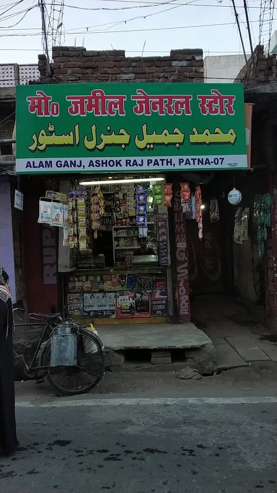

<p align="center">
  
</p>

<h1 align="center">🛒 Shalimar Store — Since 1988 (v3.4.1)</h1>

<p align="center">
  
  
  
  
  
  
  
  
  
  
</p>

---

## 🏬 Real Store Heritage

<p align="center">
  
  <br>
  <i><b>Md. Jamil General Store (Shalimar G. Store)</b> — Alamganj Main Road, Ashok Rajpath, Patna - 800007, Bihar</i>
</p>

Established in **1988** by Mohammad Jamil, **Shalimar General Store** has been a beloved neighborhood landmark for over **35+ years** in Patna.

---

## 🚀 What's New in v3.4.0

### 🔄 Real-Time Cloud Sync
- Admin changes instantly appear on all customer phones (< 1 second)
- Live streaming via Firestore; offline-first fallback
- Deletions propagate too (product removed → gone on all devices)

### 🔐 Persistent Admin Login
- Owner signs in once (`Shalimar@1988` / `Shal1mar@1988#`)
- 7-day session survives app restarts
- Automatic Firebase Auth session for Firestore write access

### 🚫 Single Active Admin Session
- Only one device holds admin role at a time
- New login on another device auto-logs previous device out
- Takeover detection via `admin_sessions/active` Firestore doc

### 🖼️ Supabase Storage Images
- Photos uploaded to Supabase Storage (not Firebase)
- Public bucket `product-images` with RLS
- URL saved in product document → all customers see same image

### 📦 Clean Production Launch
- Zero bundled demo products
- Empty store = ready for real inventory
- Customer screen: "Store is being stocked..." (no fake data)

---

## 🚀 How to Deploy

```bash
cd G:\DeepSeek\shalimar-store
git add .
git commit -m "feat(v3.4.0): real-time sync, persistent session, Supabase storage"
git push origin main --force
```

GitHub Actions builds:
- `app-arm64-v8a-release.apk` ✓
- `app-armeabi-v7a-release.apk` ✓
- `app-x86_64-release.apk` ✓

OTA updates automatically appear in-app.

---

*Built with ❤️ for Md. Jamil General Store (Est. 1988) — Patna, Bihar*