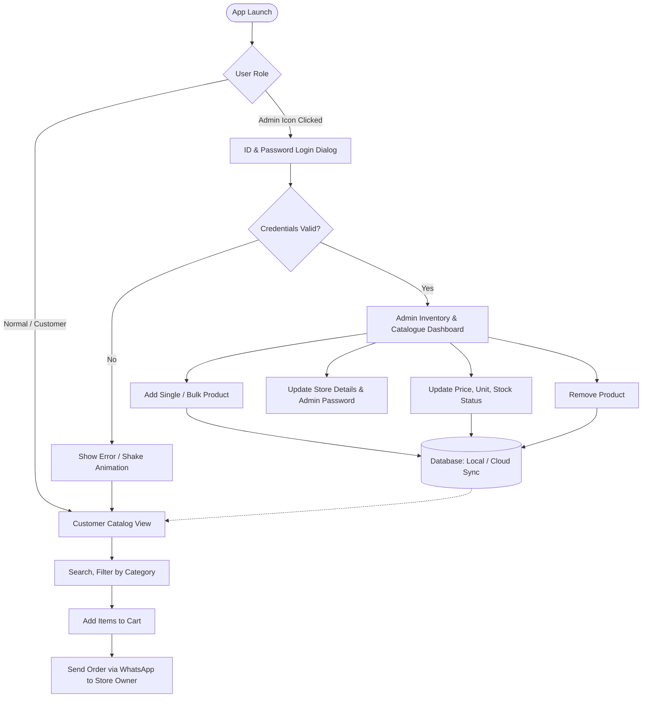

# General Store App (Shalimar Store) Implementation Plan

> **For Agent:** REQUIRED SUB-SKILL: Use superpowers:executing-plans to implement this plan task-by-task.

**Goal:** Build a single, high-performance Flutter (Dart) mobile app for a general store ("Shalimar Store") with a customer-facing catalogue browser and an admin-only management portal protected by a simple ID & Password.

**Architecture:** A single Flutter application using layered clean architecture (Models, Services/Repositories, State Management via Provider/Riverpod, and UI Views). Data persistence supports both offline-first local storage (Hive/SQLite) and cloud database sync (Firebase Firestore) so admin updates reflect in real-time.

**Tech Stack:** 
- **Framework:** Flutter 3.47+ / Dart 3.13+
- **State Management:** `provider` (or `flutter_riverpod`)
- **Database:** `hive` & `hive_flutter` (for fast offline storage) / `cloud_firestore` (for multi-device sync)
- **Local Security / Auth:** `flutter_secure_storage` or hashed SharedPreferences for Admin ID & Password
- **Utilities:** `url_launcher` (direct WhatsApp order forwarding), `intl` (currency formatting in ₹ INR), `uuid`, `image_picker` (product photos)

---

## High-Level System Workflow

---

## Database & Data Models

### 1. Product Model (`Product`)
- `id`: `String` (UUID)
- `name`: `String` (e.g., "Aashirvaad Shudh Chakki Atta")
- `category`: `String` (e.g., "Atta & Flours", "Dairy", "Spices", "Snacks")
- `price`: `double` (Selling Price in ₹)
- `mrp`: `double?` (Original MRP for showing discount)
- `unit`: `String` (e.g., "1 kg", "500 gm", "1 packet", "1 liter")
- `imageUrl`: `String?` (Network URL or local asset path)
- `inStock`: `bool` (Default: `true`)
- `description`: `String?`
- `createdAt`: `DateTime`

### 2. Category Model (`CategoryItem`)
- `id`: `String`
- `name`: `String`
- `iconName`: `String` (Material Icon representation)

### 3. Admin Credentials Structure
- `adminId`: Stored securely
- `passwordHash`: SHA-256 hashed password (Managed via secure configuration)
- `sessionActive`: In-memory session state with auto-lock on inactivity

---

## Detailed Step-by-Step Task Breakdown

### Phase 1: Project Initialization & Core Setup

#### Task 1: Initialize Flutter Project
**Files:**
- Create: `pubspec.yaml`, `lib/main.dart`
- Step 1: Run `flutter create . --project-name shalimar_store --org com.shalimar.store`
- Step 2: Add essential dependencies in `pubspec.yaml`:
  - `provider: ^6.1.2`
  - `hive: ^2.2.3`
  - `hive_flutter: ^1.1.0`
  - `intl: ^0.19.0`
  - `uuid: ^4.5.1`
  - `url_launcher: ^6.3.1`
  - `shared_preferences: ^2.3.3`
  - `crypto: ^3.0.6`
- Step 3: Run `flutter pub get` and verify project compiles.

#### Task 2: Core Theme & App Constants
**Files:**
- Create: `lib/core/theme/app_theme.dart`
- Create: `lib/core/constants/app_constants.dart`
- Design system: Warm emerald green / deep navy palette (classic grocery store aesthetic), ₹ INR currency helpers, typography rules.

---

### Phase 2: Data Layer & Services

#### Task 3: Product & Category Data Models
**Files:**
- Create: `lib/models/product.dart`
- Create: `lib/models/category_item.dart`
- Create: `lib/models/cart_item.dart`
- Test: Unit tests for JSON serialization and copyWith methods in `test/models/product_test.dart`.

#### Task 4: Admin Authentication Service
**Files:**
- Create: `lib/services/admin_auth_service.dart`
- Test: `test/services/admin_auth_service_test.dart`
- Features:
  - Default credentials initialized securely via SHA-256 hash.
  - Hashing using SHA-256 for secure comparison.
  - Persistent storage using `shared_preferences`.
  - Methods: `Future<bool> authenticate(String id, String password)`, `Future<bool> changePassword(String oldPass, String newPass)`, `bool get isLoggedIn`, `void logout()`.

#### Task 5: Catalogue Storage Service (Hive / SQLite Repository)
**Files:**
- Create: `lib/services/catalogue_service.dart`
- Features:
  - Local database CRUD: `getAllProducts()`, `addProduct(Product)`, `updateProduct(Product)`, `deleteProduct(String id)`.
  - Seeding initial sample catalog (Atta, Rice, Spices, Milk, Biscuits, Oil, Tea) so the store is not empty on first launch.
  - Bulk import capability: `Future<int> importProductsBatch(List<Product> items)`.

---

### Phase 3: Customer Facing UI (Catalog & Shopping List)

#### Task 6: State Management (CatalogueProvider & CartProvider)
**Files:**
- Create: `lib/providers/catalogue_provider.dart`
- Create: `lib/providers/cart_provider.dart`
- Logic: Search querying, category filtering, cart calculations (total items, total ₹ amount, discount savings).

#### Task 7: Customer Home Screen with Catalogue Browsing
**Files:**
- Create: `lib/views/customer/customer_home_screen.dart`
- Create: `lib/views/customer/widgets/product_card.dart`
- Create: `lib/views/customer/widgets/category_selector.dart`
- Create: `lib/views/customer/widgets/search_bar_widget.dart`
- UI elements:
  - Shalimar Store branded top bar with search bar and Admin lock icon button.
  - Horizontal scrolling category filter chips.
  - Grid/List view of items with price, unit, discount badge, and Add to Cart counter.
  - Floating Cart Summary bar showing `[X Items | ₹Total] -> View Cart`.

#### Task 8: Cart & WhatsApp Order Forwarding Screen
**Files:**
- Create: `lib/views/customer/cart_screen.dart`
- Features:
  - Detailed list of selected items with quantity increaser/decreaser.
  - Customer name and address entry (saved locally for convenience).
  - "Place Order on WhatsApp" button: Formats order items neatly (Item, Quantity, Price, Total Bill) and opens WhatsApp directly to Shalimar Store owner's phone number.

---

### Phase 4: Admin Portal (Protected by ID & Password)

#### Task 9: Simple Admin Login Dialog / Screen
**Files:**
- Create: `lib/views/admin/admin_login_dialog.dart`
- Features:
  - Clean modal dialog or dedicated screen triggered from the top-bar key icon.
  - Fields: `Admin ID` and `Password`.
  - Simple show/hide password toggle.
  - Validation: Authenticates against `AdminAuthService`.
  - Shake animation or red warning on incorrect credentials.

#### Task 10: Admin Dashboard & Inventory Management
**Files:**
- Create: `lib/views/admin/admin_dashboard_screen.dart`
- Features:
  - Inventory Overview: Total items count, low stock/out-of-stock items filter.
  - Quick Stock Toggle: 1-tap toggle to mark any item "In Stock" or "Out of Stock".
  - Floating Action Button: "Add New Item".
  - "Bulk Add Catalogue" button for rapid inventory loading.
  - Top Action: "Change Admin Password" and "Store Settings".

#### Task 11: Add / Edit Product Screen
**Files:**
- Create: `lib/views/admin/add_edit_product_screen.dart`
- Form fields:
  - Product Name (Required)
  - Category dropdown (Atta & Grains, Oil & Ghee, Masale/Spices, Snacks, Beverages, Dairy, Cleaning, etc.)
  - Selling Price (₹) & MRP (₹)
  - Unit / Pack size (e.g. 500g, 1kg, 200ml, 1 pc)
  - Image URL or predefined asset icon picker
  - Stock switch (Available / Sold Out)
- Save / Delete confirmation dialog.

#### Task 12: Bulk Catalogue Entry & Sample Data Loader
**Files:**
- Create: `lib/views/admin/bulk_catalogue_screen.dart`
- Features:
  - Quick multi-add table or Paste JSON/CSV format.
  - "Load Standard Indian Kirana Store Catalogue" button: Instantly loads 50+ pre-filled popular grocery items with standard Indian units & prices for immediate testing and use.

---

### Phase 5: Verification, Polish & Build

#### Task 13: End-to-End Verification
- Test 1: App launches in Customer Mode without requiring password.
- Test 2: Admin clicks login icon, enters wrong ID/password -> Access denied.
- Test 3: Admin enters correct ID/password -> Successfully unlocks Admin Panel.
- Test 4: Admin adds a new product -> Verify it appears instantly in the customer catalogue.
- Test 5: Admin toggles product to "Out of Stock" -> Customer card reflects "Out of Stock" and disables addition.
- Test 6: Customer adds 3 items to cart -> clicks WhatsApp Order -> WhatsApp opens with correctly formatted text message.

#### Task 14: Windows & Android Build Verification
- Run `flutter analyze`
- Run `flutter test`
- Build test executable or APK.

